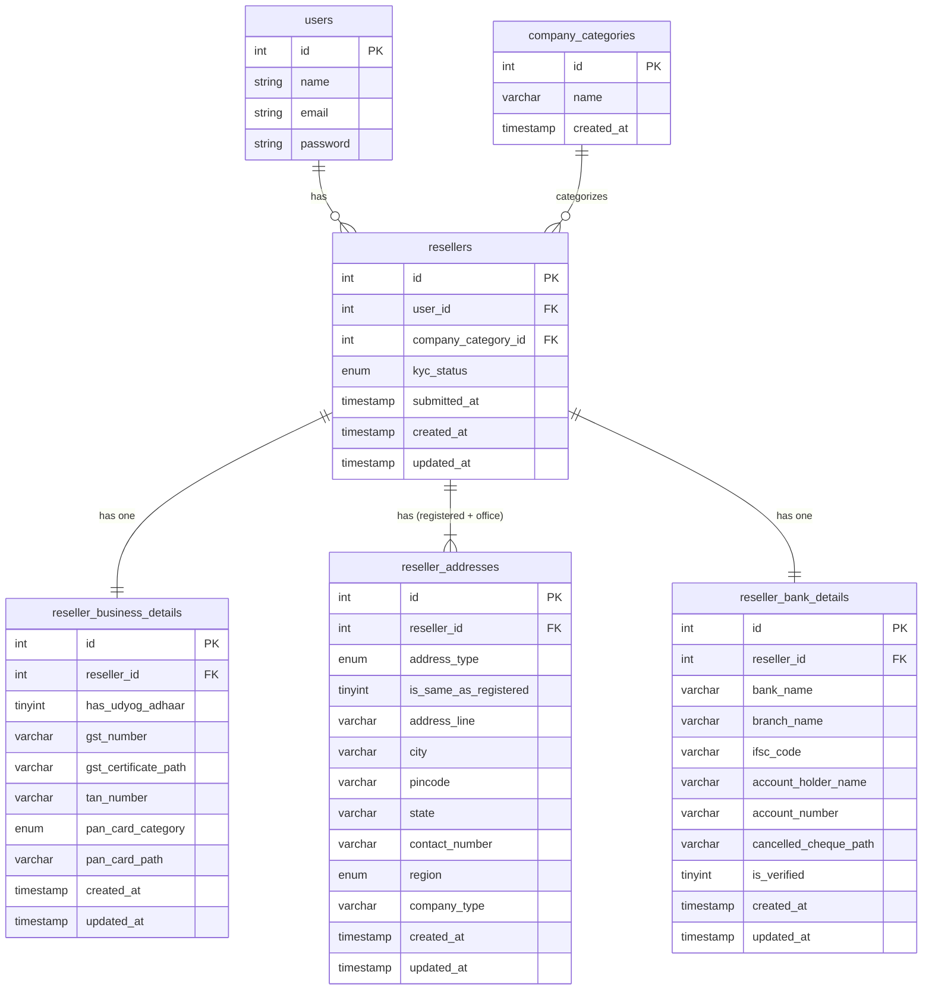

# 🗄️ Reseller KYC Registration — Database Design

## 1. Form Field Analysis

The form is a **4-step wizard** with the following fields:

| Step | Field | Input Type | Notes |
|------|-------|-----------|-------|
| 1 — Basic Details | Company Category | `<select>` | IT Services, Cloud Solutions, etc. |
| 2 — Business Details | Udyog Adhaar | Radio (yes/no) | Boolean flag |
| 2 — Business Details | GST Number | Text | Unique per company |
| 2 — Business Details | Upload GST Certificate | File | Stored as file path |
| 2 — Business Details | TAN Number | Text | |
| 2 — Business Details | PAN Card Category | `<select>` | Individual, Company, HUF, Firm, Trust |
| 2 — Business Details | Upload PAN Card | File | Stored as file path |
| 3 — Address Details | Registered Address | Text | |
| 3 — Address Details | Registered City | Text | |
| 3 — Address Details | Registered Pincode | Text | |
| 3 — Address Details | Registered State | Text | |
| 3 — Address Details | Registered Contact Number | Tel | |
| 3 — Address Details | Registered Region | `<select>` | North/South/East/West |
| 3 — Address Details | Registered Company Type | Text | |
| 3 — Address Details | Office/Delivery same as Registered? | Radio | Boolean flag |
| 3 — Address Details | Office Address | Text | |
| 3 — Address Details | Office City | Text | |
| 3 — Address Details | Office Pincode | Text | |
| 3 — Address Details | Office State | Text | |
| 3 — Address Details | Office Contact Number | Tel | |
| 3 — Address Details | Office Region | `<select>` | North/South/East/West |
| 3 — Address Details | Office Company Type | Text | |
| 4 — Bank Details | IFSC Code | Text | |
| 4 — Bank Details | Branch Name | Text | |
| 4 — Bank Details | Account Holder Name | Text | |
| 4 — Bank Details | Bank Name | Text | |
| 4 — Bank Details | Account Number | Text | |
| 4 — Bank Details | Upload Canceled Cheque | File | Stored as file path |

---

## 2. Database Structure — Explanation

After normalization, the data is split into **5 tables**:

### Entities Identified

1. **`company_categories`** — Lookup table for company category options (to avoid hardcoding and duplication).
2. **`resellers`** — Core entity linking all KYC steps to a user/reseller.
3. **`reseller_business_details`** — Business-specific fields (GST, PAN, TAN, Udyog Adhaar).
4. **`reseller_addresses`** — Handles both `registered` and `office/delivery` addresses using an `address_type` discriminator column (normalized — avoids duplicating address columns).
5. **`reseller_bank_details`** — Bank account details.

### Relationships
| Relationship | Type | Description |
|---|---|---|
| `resellers` → `company_categories` | **N:1** | Many resellers can belong to one category |
| `resellers` → `reseller_business_details` | **1:1** | One reseller has one business record |
| `resellers` → `reseller_addresses` | **1:N** | One reseller can have multiple addresses (registered + office) |
| `resellers` → `reseller_bank_details` | **1:1** | One reseller has one bank account |

---

## 3. Table Definitions

### `company_categories`
| Column | Type | Constraints | Description |
|--------|------|-------------|-------------|
| `id` | INT | PK, AUTO_INCREMENT | |
| `name` | VARCHAR(100) | NOT NULL, UNIQUE | e.g., IT Services |
| `created_at` | TIMESTAMP | DEFAULT NOW() | |

---

### `resellers`
| Column | Type | Constraints | Description |
|--------|------|-------------|-------------|
| `id` | INT | PK, AUTO_INCREMENT | |
| `user_id` | INT | FK → `users.id`, NOT NULL | Linked to auth user |
| `company_category_id` | INT | FK → `company_categories.id` | Step 1 |
| `kyc_status` | ENUM | `pending`, `approved`, `rejected` | Overall KYC status |
| `submitted_at` | TIMESTAMP | NULLABLE | When form was submitted |
| `created_at` | TIMESTAMP | DEFAULT NOW() | |
| `updated_at` | TIMESTAMP | DEFAULT NOW() | |

---

### `reseller_business_details`
| Column | Type | Constraints | Description |
|--------|------|-------------|-------------|
| `id` | INT | PK, AUTO_INCREMENT | |
| `reseller_id` | INT | FK → `resellers.id`, UNIQUE | 1:1 with reseller |
| `has_udyog_adhaar` | TINYINT(1) | DEFAULT 0 | Radio: yes=1, no=0 |
| `gst_number` | VARCHAR(20) | NULLABLE | |
| `gst_certificate_path` | VARCHAR(500) | NULLABLE | File upload path |
| `tan_number` | VARCHAR(20) | NULLABLE | |
| `pan_card_category` | ENUM | `Individual`,`Company`,`HUF`,`Firm`,`Trust` | |
| `pan_card_path` | VARCHAR(500) | NULLABLE | File upload path |
| `created_at` | TIMESTAMP | DEFAULT NOW() | |
| `updated_at` | TIMESTAMP | DEFAULT NOW() | |

---

### `reseller_addresses`
| Column | Type | Constraints | Description |
|--------|------|-------------|-------------|
| `id` | INT | PK, AUTO_INCREMENT | |
| `reseller_id` | INT | FK → `resellers.id`, NOT NULL | |
| `address_type` | ENUM | `registered`, `office` | Discriminator |
| `is_same_as_registered` | TINYINT(1) | DEFAULT 0 | Radio flag on form |
| `address_line` | VARCHAR(500) | NOT NULL | |
| `city` | VARCHAR(100) | NOT NULL | |
| `pincode` | VARCHAR(10) | NOT NULL | |
| `state` | VARCHAR(100) | NOT NULL | |
| `contact_number` | VARCHAR(15) | NOT NULL | |
| `region` | ENUM | `North`,`South`,`East`,`West` | |
| `company_type` | VARCHAR(100) | NULLABLE | |
| `created_at` | TIMESTAMP | DEFAULT NOW() | |
| `updated_at` | TIMESTAMP | DEFAULT NOW() | |

> **Design Note:** Using a single `reseller_addresses` table with `address_type` ENUM is cleaner than having two separate tables or duplicate columns. A `UNIQUE(reseller_id, address_type)` constraint ensures only one registered and one office address per reseller.

---

### `reseller_bank_details`
| Column | Type | Constraints | Description |
|--------|------|-------------|-------------|
| `id` | INT | PK, AUTO_INCREMENT | |
| `reseller_id` | INT | FK → `resellers.id`, UNIQUE | 1:1 with reseller |
| `bank_name` | VARCHAR(100) | NOT NULL | |
| `branch_name` | VARCHAR(100) | NOT NULL | |
| `ifsc_code` | VARCHAR(15) | NOT NULL | |
| `account_holder_name` | VARCHAR(200) | NOT NULL | |
| `account_number` | VARCHAR(30) | NOT NULL | |
| `cancelled_cheque_path` | VARCHAR(500) | NULLABLE | File upload path |
| `is_verified` | TINYINT(1) | DEFAULT 0 | IFSC Verify button result |
| `created_at` | TIMESTAMP | DEFAULT NOW() | |
| `updated_at` | TIMESTAMP | DEFAULT NOW() | |

---

## 4. SQL CREATE TABLE Queries

```sql
-- ─────────────────────────────────────────
-- 1. Lookup: Company Categories
-- ─────────────────────────────────────────
CREATE TABLE company_categories (
    id         INT          NOT NULL AUTO_INCREMENT,
    name       VARCHAR(100) NOT NULL,
    created_at TIMESTAMP    NOT NULL DEFAULT CURRENT_TIMESTAMP,
    PRIMARY KEY (id),
    UNIQUE KEY uq_category_name (name)
);

-- Seed data
INSERT INTO company_categories (name) VALUES
    ('IT Services'),
    ('Cloud Solutions'),
    ('Software Development'),
    ('Consulting'),
    ('Other');

-- ─────────────────────────────────────────
-- 2. Core: Resellers
-- ─────────────────────────────────────────
CREATE TABLE resellers (
    id                  INT          NOT NULL AUTO_INCREMENT,
    user_id             INT          NOT NULL,
    company_category_id INT          NULL,
    kyc_status          ENUM('pending','approved','rejected')
                                     NOT NULL DEFAULT 'pending',
    submitted_at        TIMESTAMP    NULL,
    created_at          TIMESTAMP    NOT NULL DEFAULT CURRENT_TIMESTAMP,
    updated_at          TIMESTAMP    NOT NULL DEFAULT CURRENT_TIMESTAMP ON UPDATE CURRENT_TIMESTAMP,
    PRIMARY KEY (id),
    CONSTRAINT fk_reseller_user     FOREIGN KEY (user_id)             REFERENCES users(id)               ON DELETE CASCADE,
    CONSTRAINT fk_reseller_category FOREIGN KEY (company_category_id) REFERENCES company_categories(id)  ON DELETE SET NULL
);

-- ─────────────────────────────────────────
-- 3. Business Details  (1:1 with resellers)
-- ─────────────────────────────────────────
CREATE TABLE reseller_business_details (
    id                   INT           NOT NULL AUTO_INCREMENT,
    reseller_id          INT           NOT NULL,
    has_udyog_adhaar     TINYINT(1)    NOT NULL DEFAULT 0,
    gst_number           VARCHAR(20)   NULL,
    gst_certificate_path VARCHAR(500)  NULL,
    tan_number           VARCHAR(20)   NULL,
    pan_card_category    ENUM('Individual','Company','HUF','Firm','Trust') NULL,
    pan_card_path        VARCHAR(500)  NULL,
    created_at           TIMESTAMP     NOT NULL DEFAULT CURRENT_TIMESTAMP,
    updated_at           TIMESTAMP     NOT NULL DEFAULT CURRENT_TIMESTAMP ON UPDATE CURRENT_TIMESTAMP,
    PRIMARY KEY (id),
    UNIQUE KEY uq_business_reseller (reseller_id),
    CONSTRAINT fk_business_reseller FOREIGN KEY (reseller_id) REFERENCES resellers(id) ON DELETE CASCADE
);

-- ─────────────────────────────────────────
-- 4. Addresses  (1:N — registered & office)
-- ─────────────────────────────────────────
CREATE TABLE reseller_addresses (
    id                    INT           NOT NULL AUTO_INCREMENT,
    reseller_id           INT           NOT NULL,
    address_type          ENUM('registered','office') NOT NULL,
    is_same_as_registered TINYINT(1)    NOT NULL DEFAULT 0,
    address_line          VARCHAR(500)  NOT NULL,
    city                  VARCHAR(100)  NOT NULL,
    pincode               VARCHAR(10)   NOT NULL,
    state                 VARCHAR(100)  NOT NULL,
    contact_number        VARCHAR(15)   NOT NULL,
    region                ENUM('North','South','East','West') NULL,
    company_type          VARCHAR(100)  NULL,
    created_at            TIMESTAMP     NOT NULL DEFAULT CURRENT_TIMESTAMP,
    updated_at            TIMESTAMP     NOT NULL DEFAULT CURRENT_TIMESTAMP ON UPDATE CURRENT_TIMESTAMP,
    PRIMARY KEY (id),
    UNIQUE KEY uq_address_type (reseller_id, address_type),
    CONSTRAINT fk_address_reseller FOREIGN KEY (reseller_id) REFERENCES resellers(id) ON DELETE CASCADE
);

-- ─────────────────────────────────────────
-- 5. Bank Details  (1:1 with resellers)
-- ─────────────────────────────────────────
CREATE TABLE reseller_bank_details (
    id                    INT           NOT NULL AUTO_INCREMENT,
    reseller_id           INT           NOT NULL,
    bank_name             VARCHAR(100)  NOT NULL,
    branch_name           VARCHAR(100)  NOT NULL,
    ifsc_code             VARCHAR(15)   NOT NULL,
    account_holder_name   VARCHAR(200)  NOT NULL,
    account_number        VARCHAR(30)   NOT NULL,
    cancelled_cheque_path VARCHAR(500)  NULL,
    is_verified           TINYINT(1)    NOT NULL DEFAULT 0,
    created_at            TIMESTAMP     NOT NULL DEFAULT CURRENT_TIMESTAMP,
    updated_at            TIMESTAMP     NOT NULL DEFAULT CURRENT_TIMESTAMP ON UPDATE CURRENT_TIMESTAMP,
    PRIMARY KEY (id),
    UNIQUE KEY uq_bank_reseller (reseller_id),
    CONSTRAINT fk_bank_reseller FOREIGN KEY (reseller_id) REFERENCES resellers(id) ON DELETE CASCADE
);
```

---

## 5. ER Diagram (Mermaid)



---

## 6. Key Design Decisions

| Decision | Reason |
|---|---|
| `company_categories` as a separate table | Avoids hardcoding options in the DB; easy to add/remove categories later |
| Single `reseller_addresses` table with `address_type` ENUM | DRY principle — both address blocks have identical fields; `UNIQUE(reseller_id, address_type)` enforces integrity |
| File columns stored as `VARCHAR(500)` paths | Files are stored on disk/cloud (S3/local), not in the DB as BLOBs |
| `is_same_as_registered` flag on address row | Enables frontend to auto-copy registered address fields when set to `yes` |
| `is_verified` on bank details | Tracks IFSC verification button result |
| `kyc_status` ENUM on `resellers` | Central status field for admin review workflow |
| `UNIQUE KEY` on `reseller_id` in 1:1 tables | Enforces the 1:1 relationship at the database level |
